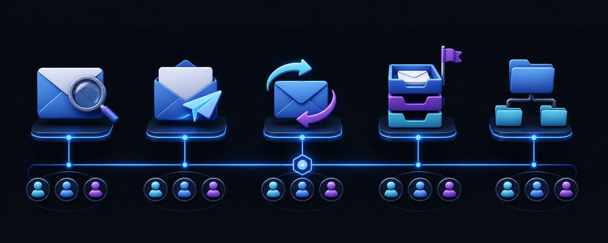

<p align="center">
  
</p>

# Email SMTP/IMAP MCP

One local MCP server for every inbox: search, read, send, reply, forward, and organize email across multiple accounts.

[](https://github.com/samihalawa/email-smtp-imap-mcp/releases/latest)
[](https://www.npmjs.com/package/email-smtp-imap-mcp)
[](https://www.npmjs.com/package/email-smtp-imap-mcp)
[](https://github.com/samihalawa/email-smtp-imap-mcp/actions/workflows/ci.yml)
[](https://nodejs.org/)
[](https://github.com/samihalawa/email-smtp-imap-mcp/stargazers)
[](LICENSE)

## Why this server

- **No account-count cap** — add work, personal, support, or client inboxes and switch with `account_name`.
- **SMTP + IMAP together** — send and receive through one small MCP server.
- **Complete everyday workflow** — search, read, reply, forward, attach files, flag, archive, move, and list folders.
- **Provider-agnostic** — works with Gmail, iCloud Mail, Fastmail, Outlook, self-hosted mail, and other standard SMTP/IMAP providers.
- **Local stdio transport** — no hosted relay and no separate control panel.

<p align="center">
  
</p>

## Quick start

### 1. Create your `.env`

Copy [.env.example](.env.example) to a private location and add as many named accounts as you need:

```dotenv
EMAIL_ACCOUNTS_JSON='{
  "work": {
    "smtp": {
      "host": "smtp.gmail.com",
      "port": 587,
      "secure": false,
      "user": "work@example.com",
      "password": "app-password"
    },
    "imap": {
      "host": "imap.gmail.com",
      "port": 993,
      "secure": true,
      "user": "work@example.com",
      "password": "app-password"
    },
    "default_from_name": "Your Name",
    "sender_emails": ["work@example.com", "alias@example.com"]
  },
  "personal": {
    "smtp": {
      "host": "smtp.mail.me.com",
      "port": 587,
      "secure": false,
      "user": "you@icloud.com",
      "password": "app-password"
    },
    "imap": {
      "host": "imap.mail.me.com",
      "port": 993,
      "secure": true,
      "user": "you@icloud.com",
      "password": "app-password"
    }
  }
}'

DEFAULT_EMAIL_ACCOUNT="work"
```

The server loads `.env` from its working directory automatically. `EMAIL_ENV_FILE` lets an MCP client use an `.env` stored anywhere.

### 2. Add the MCP server

For Claude Desktop, edit:

- macOS: `~/Library/Application Support/Claude/claude_desktop_config.json`
- Windows: `%APPDATA%\Claude\claude_desktop_config.json`

```json
{
  "mcpServers": {
    "email": {
      "command": "npx",
      "args": ["-y", "email-smtp-imap-mcp"],
      "env": {
        "EMAIL_ENV_FILE": "/absolute/path/to/your/.env"
      }
    }
  }
}
```

Use an absolute path, restart your MCP client, then ask: **“List my configured email accounts.”**

<details>
<summary>Pass account JSON directly from the MCP client</summary>

You can skip the `.env` file and set `EMAIL_ACCOUNTS_JSON` plus `DEFAULT_EMAIL_ACCOUNT` directly in the MCP client’s `env` object. The JSON must be escaped into a single string.

```json
{
  "env": {
    "EMAIL_ACCOUNTS_JSON": "{\"work\":{\"smtp\":{\"host\":\"smtp.gmail.com\",\"port\":587,\"user\":\"work@example.com\",\"password\":\"app-password\"},\"imap\":{\"host\":\"imap.gmail.com\",\"port\":993,\"user\":\"work@example.com\",\"password\":\"app-password\"}}}",
    "DEFAULT_EMAIL_ACCOUNT": "work"
  }
}
```

</details>

<details>
<summary>Single-account `.env` variables</summary>

Use `SMTP_HOST`, `SMTP_PORT`, `SMTP_SECURE`, `SMTP_USER`, `SMTP_PASS`, `IMAP_HOST`, `IMAP_PORT`, `IMAP_SECURE`, `IMAP_USER`, and `IMAP_PASS` instead of `EMAIL_ACCOUNTS_JSON`.

`SMTP_USERNAME`/`SMTP_PASSWORD` and `IMAP_USERNAME`/`IMAP_PASSWORD` are accepted aliases. IMAP credentials default to the SMTP credentials when omitted. Use `SENDER_EMAILS` as a comma-separated allowlist for optional `from_email` selection.

</details>

### Saving sent mail

SMTP only delivers a message; it does not put a copy in your Sent folder. Providers such as Gmail do that server-side, but many others (IONOS, Strato, most self-hosted servers) do not. Set `SAVE_TO_SENT=true` (or `"save_to_sent": true` per account in `EMAIL_ACCOUNTS_JSON`) to store every message sent by `email_send` and `email_respond` in the IMAP Sent folder, marked as read and including Bcc recipients.

The folder is the one flagged `\Sent` by the server, falling back to `Sent`. Set `SENT_FOLDER` (or `"sent_folder"`) to use another one, e.g. `SENT_FOLDER="Gesendete Objekte"`. Send results then include `sent_copy` with `saved`, `folder` and, if storing failed, `error`; the mail itself is still delivered in that case. Leave it off for providers that already store sent mail, or you get duplicates.

### Safety switches

Per account (environment variable, or the lowercase key in `EMAIL_ACCOUNTS_JSON`):

| Setting | Default | Effect |
| --- | --- | --- |
| `READ_ONLY` | `false` | Only `accounts_list`, `emails_find` and `folders_list` work. Sending, replying, drafts, flag changes, moving, deleting and folder changes are refused, and searching does not mark mail as read. |
| `ALLOW_DELETE` | `true` | `false` blocks `emails_modify` with `delete`. Moving messages to a folder stays possible. |
| `ALLOW_PERMANENT_DELETE` | `false` | Must be `true` for `delete` with `permanent` and for `folder_delete`. Both cannot be undone. |

`accounts_list` shows the active switches for every account.

### Connections

IMAP connections are kept open for 30 seconds after use and reused, because logging in is the slowest part of most operations and some providers limit logins. Set `IMAP_KEEPALIVE_SECONDS` to change the time, or to `0` to open one connection per call. A connection the server has closed is replaced automatically, and parked connections are closed when the MCP client disconnects.

### Bulk actions

`emails_modify` can act on everything that matches `filters` and/or `query` instead of a list of IDs, up to 500 emails per call. A selection must be confirmed in two steps: call it once with `dry_run: true` to see how many emails match plus a sample, then repeat it with `expected_count` set to that number. If the count has changed in the meantime, the call is refused. A selection without any filter or query is rejected.

## Tools

| Tool | What it does |
| --- | --- |
| `accounts_list` | List every configured account and identify the default without exposing credentials. |
| `emails_find` | Search by text, sender, recipient, CC/BCC, subject, date, size, read, flag, answered, forwarded and draft state, custom keywords, or attachments in INBOX or any `folder`. Pages with `limit`/`offset` (`total_found`, `has_more`, `next_offset`) and `order`. Optionally returns bodies. Custom flags show up as `keywords`. Results list attachments in `attachment_list`; `include_attachments` inlines all of them as base64. |
| `attachment_get` | Download one attachment (base64, up to 25 MB) by filename or part id, from INBOX or any `folder`. |
| `emails_wait` | Wait (up to 120 s) until new mail arrives in a folder, optionally only matching `filters`, and return it. Uses IMAP IDLE with a 15 s re-check, so it also works on servers without IDLE. `next_uid` lets the next call continue where this one stopped. |
| `email_send` | Send plain-text or HTML email with CC, BCC, sender aliases, base64 attachments, `reply_to`, `priority`, `read_receipt` and custom `headers`. |
| `email_respond` | Reply, reply-all, or forward by email UID (from INBOX or any `folder`) with threading and optional original attachments. The original is flagged `\Answered` or `$Forwarded`. |
| `emails_modify` | Mark read/unread, flag/unflag, add or remove custom keywords (`add_keywords`, `remove_keywords`), mark as spam or not spam, move or copy to another folder, or delete (to Trash by default; `permanent: true` removes for good and needs `ALLOW_PERMANENT_DELETE`). Select by `email_ids`, or in bulk by `filters`/`query`. Works on any source `folder`. |
| `draft_create` | Save a plain-text or HTML draft with optional recipients, attachments and the same send options as `email_send` to the Drafts folder without sending it. With `reply_to_email_id` the draft answers an existing message (recipient, `Re:` subject, threading headers and quoted original are filled in). |
| `draft_update` | Change fields of a draft (recipients, subject, body, attachments, send options). The draft is rewritten, so it gets a new `email_id`. |
| `draft_send` | Send a stored draft and remove it from the Drafts folder. |
| `draft_delete` | Delete drafts: to Trash by default, `permanent: true` needs `ALLOW_PERMANENT_DELETE`. |
| `folder_create` | Create a folder or subfolder such as `Projects/2026`. |
| `folder_rename` | Rename a folder or move it in the tree (`Projects/2026` to `Archive/2026`). Messages and subfolders go with it. INBOX and special folders are protected. |
| `folder_empty` | Permanently empty the Trash or Junk folder, optionally only messages older than N days. Needs `ALLOW_PERMANENT_DELETE`. |
| `folder_delete` | Delete a folder and its messages (needs `ALLOW_PERMANENT_DELETE`). INBOX and special folders (Sent, Drafts, Trash, ...) are protected. |
| `folders_list` | List folders with path, parent, separator, special-use type (`\Sent`, `\Drafts`, `\Trash`, ...) and optional total and unread counts. |

Every email tool accepts an optional `account_name`. Without it, the server uses `DEFAULT_EMAIL_ACCOUNT` or the first configured account. There is no application-level account-count limit.

## Verify your setup

After restarting the MCP client, try these in order:

1. “List my configured email accounts.”
2. “List folders for my `work` account.”
3. “Find the five newest unread emails in my `personal` account.”
4. “Send a plain-text email from my `work` account.”

## Provider settings

| Provider | SMTP | IMAP | Credential |
| --- | --- | --- | --- |
| Gmail | `smtp.gmail.com:587` | `imap.gmail.com:993` | [App password](https://support.google.com/accounts/answer/185833) |
| iCloud Mail | `smtp.mail.me.com:587` | `imap.mail.me.com:993` | [App-specific password](https://support.apple.com/en-us/102654) |
| Other providers | Use the provider's SMTP host | Use the provider's IMAP host | Provider password or app password |

Use `secure: true` for implicit TLS ports such as 465/993. Port 587 normally uses `secure: false` and upgrades with STARTTLS.

## Development

```bash
git clone https://github.com/samihalawa/email-smtp-imap-mcp.git
cd email-smtp-imap-mcp
npm ci
npm test
```

`npm test` also runs integration tests against a real Dovecot IMAP server in Docker (`test/docker`), with an SMTP stub that delivers mail between two test accounts. They are skipped automatically when Docker is not available.

To check a real provider, copy `.env.live.example` to `.env.live` (git-ignored), fill in two mailboxes and run `npm run test:live`. The test sends mail between the two accounts, creates its own folders and removes everything it created: it only touches messages whose subject carries a unique run id. Set `IMAP_DEBUG_LOG=/tmp/imap.log` to record the IMAP conversation of the server for diagnosis (passwords are masked, but folder names, subjects and addresses are visible). At the end it prints provider findings such as the detected Sent, Junk and Trash folders.

Run the compiled stdio server with `npm start`. Build a production container with `docker build -t email-smtp-imap-mcp .`.

## Contributing

Issues and focused pull requests are welcome. See [CONTRIBUTING.md](CONTRIBUTING.md) for the development workflow and [SECURITY.md](SECURITY.md) for vulnerability reports.

## License

[MIT](LICENSE) © Sami Halawa
